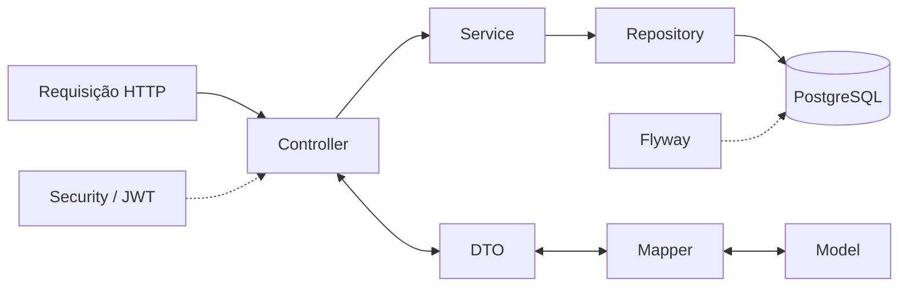
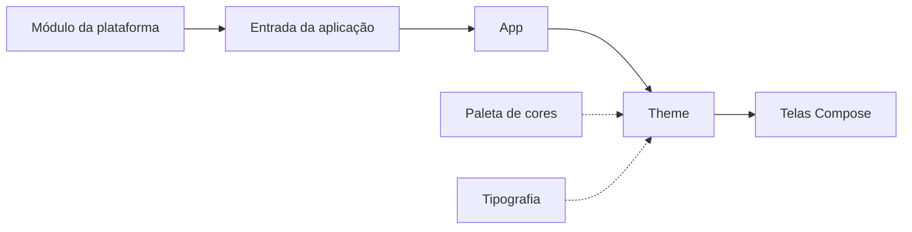

<br/>

<h2 align="start"> 
   
  <b>Identificação</b>
</h2>

- **Projeto:** Greenhouse
- **Grupo:** Lovelace
- **Repositório do Github:** https://github.com/Best-of-the-class/Greenhouse

<h2 align="start"> 
   
  <b>Integrantes e Responsabilidades</b>
</h2>

Abaixo, estão listadas as integrantes da equipe e suas respectivas responsabilidades:

| ✿ | Integrante | RA | Bloco | Entidades/CRUDs sob responsabilidade | GitHub |
|---|---|---|---|---|---|
|  | Amanda Brito | 1111392411036 | Plantas/IoT | Espécie/cuidados e configuração de Alertas | [GitHub][link-amanda] |
|  | Anahi Mamani | 1111392411027 | Vendas | Cliente e Pedido | [GitHub][link-anahi] |
|  | Débora Carvalho | 1111392411046 | Estoque/Comercial | Estoque e Desconto | [GitHub][link-debora] |
|  | Isabella Gonçalves | 1111392411043 | Catálogo | Categoria e Produto | [GitHub][link-isabella] |
|  | Julia Bongiovani | 1111392411028 | Compras | Fornecedor e Compra | [GitHub][link-julia] |
|  | Luna Leão | 1111392421043 | Acesso | Funcionário, Forma de pagamento, Autenticação | [GitHub][link-luna] |

<!-- Referências dos perfis -->
[link-amanda]: https://github.com/Amanda-Brit0
[link-anahi]: https://github.com/AnahiMamani
[link-debora]: https://github.com/Debora-Carvalho
[link-isabella]: https://github.com/IsabellaSGoncalves
[link-julia]: https://github.com/BONJIU
[link-luna]: https://github.com/LunaLeao

As tabelas auxiliares são utilizadas pelos respectivos fluxos, como itens de pedido, itens de compra e relações entre produtos, categorias e espécies.

<h2 align="start"> 
   
  <b>Sobre a aplicação</b>
</h2>

**Greenhouse** é uma plataforma para apoiar a gestão de floriculturas. O backend oferece uma API para operações de cadastro e gerenciamento de dados como funcionários, clientes, fornecedores, categorias, produtos, formas de pagamento, descontos e estoque. O modelo do banco também contempla pedidos e compras, espécies de plantas, dispositivos IoT, leituras ambientais e configuração de alertas.

A centralização desses dados e regras ajuda a reduzir controles manuais e inconsistências entre catálogo, estoque e operações da loja. As validações de domínio e persistência ficam no backend, enquanto o banco aplica restrições de integridade. O estoque, por exemplo, controla quantidades físicas e reservadas; os descontos aceitam percentuais ou valores fixos sujeitos às regras cadastradas.

O backend é a camada de API e persistência. As aplicações Android, iOS, Desktop e Web compartilham a interface Compose Multiplatform. O Swagger/OpenAPI pode ser utilizado para explorar a API.

### Objetivos de Desenvolvimento Sustentável (ODS)

O Greenhouse busca contribuir para os Objetivos de Desenvolvimento Sustentável da ONU por meio da digitalização e do aprimoramento da gestão de floriculturas.

**ODS 12** - Consumo e produção responsáveis: apoio ao controle de estoque e às condições de conservação das plantas, contribuindo para a redução de perdas e desperdícios.

**ODS 9** - Indústria, inovação e infraestrutura: utilização de tecnologias digitais e IoT para modernizar o gerenciamento e o monitoramento das plantas.

**ODS 8** - Trabalho decente e crescimento econômico: organização dos processos comerciais e operacionais, incluindo vendas, compras, fornecedores e estoque.

<h2 align="start"> 
   
  <b>Tecnologias</b>
</h2>

- Kotlin e Gradle
- Kotlin Multiplatform e Compose Multiplatform
- Spring Boot e Spring Data JPA
- PostgreSQL
- Flyway para versionamento de migrations
- Spring Security e JWT para autenticação/autorização
- OpenAPI/Swagger para documentação da API
- Docker e Jib para empacotamento do backend
- Android, iOS, Desktop (JVM), JavaScript e Kotlin/Wasm como targets cliente

<h2 align="start"> 
   
  <b>Arquiteturas e pastas</b>
</h2>

O repositório do projeto está organizado da seguinte forma:

```txt
Greenhouse/
├── serverApp/                                  # Backend Kotlin/JVM
│   └── src/main/
│       ├── kotlin/org/greenhouse/
│       │   ├── controller/                    # Endpoints REST
│       │   ├── service/                        # Regras de aplicação e domínio
│       │   ├── repository/                     # Consultas e persistência
│       │   ├── model/                          # Entidades JPA
│       │   ├── dto/                            # Contratos de entrada e saída
│       │   │   ├── request/
│       │   │   └── response/
│       │   ├── mapper/                         # Conversão entre entidades e DTOs
│       │   ├── security/                       # Configuração JWT e segurança
│       │   ├── adapter/                        # Configurações e tratamento de exceções
│       │   ├── enums/                          # Enumerações de domínio
│       │   └── Main.kt                         # Inicialização do backend
│       └── resources/
│           ├── db/migration/                   # Migrations do Flyway
│           ├── openapi/                        # Arquivos relacionados à OpenAPI
│           ├── openapi.yaml                    # Contrato OpenAPI
│           └── application.properties          # Configuração da aplicação
│
├── shared/                                     # Código multiplataforma compartilhado
│   └── src/
│       ├── commonMain/
│       │   ├── kotlin/org/greenhouse/
│       │   │   ├── App.kt                      # Raiz da interface Compose
│       │   │   └── ui/
│       │   │       ├── screens/home/           # Tela inicial
│       │   │       └── theme/                  # Cores, fontes e tema
│       │   └── composeResources/drawable/      # Ícones e imagens compartilhados
│       ├── androidMain/                        # Implementações específicas do Android
│       ├── iosMain/                            # Implementações específicas do iOS
│       ├── jvmMain/                            # Implementações para JVM/Desktop
│       ├── jsMain/                             # Implementações para Web/JS
│       ├── wasmJsMain/                         # Implementações para WebAssembly
│       ├── commonTest/                         # Testes comuns
│       ├── androidHostTest/                    # Testes executados na JVM para Android
│       ├── iosTest/                            # Testes do target iOS
│       ├── jvmTest/                            # Testes JVM; atualmente também contém testes do backend
│       └── webTest/                            # Testes do target Web
│
├── androidApp/                                 # Aplicação Android
│   └── src/main/                               # Entrada Android (MainActivity.kt)
├── iosApp/                                     # Projeto nativo iOS aberto pelo Xcode
├── desktopApp/                                 # Aplicação Desktop JVM
│   └── src/main/                               # Entrada Desktop (main.kt)
└── webApp/                                     # Aplicação Web
    └── src/webMain/                            # Entrada Web (main.kt)
```

### Backend (`serverApp`)

O backend é uma aplicação Kotlin/JVM independente. Seu código principal está em `serverApp/src/main/kotlin/org/greenhouse/`:

| Pasta | Responsabilidade |
|---|---|
| `controller/` | Endpoints REST e tradução de requisições/respostas HTTP |
| `service/` | Regras de aplicação e validações de domínio |
| `repository/` | Persistência e consultas Spring Data JPA |
| `model/` | Entidades JPA mapeadas para o banco |
| `dto/` | Contratos de entrada e saída da API |
| `mapper/` | Conversão entre entidades e DTOs |
| `security/` | Autenticação JWT e configuração de autorização |
| `adapter/` | Tratamento de exceções e configurações da aplicação |
| `enums/` | Enumerações de domínio |

As migrations Flyway ficam em `serverApp/src/main/resources/db/migration/`. A configuração da aplicação está em `serverApp/src/main/resources/application.properties`; os contratos OpenAPI ficam em `serverApp/src/main/resources/openapi/` e no arquivo `serverApp/src/main/resources/openapi.yaml`.


### Fluxo geral do Backend



O Flyway gerencia a evolução do schema e o Hibernate está configurado para validar o mapeamento (`ddl-auto=validate`), sem alterar o schema automaticamente.

### Frontend e código multiplataforma (`shared`)

O frontend usa **Compose Multiplatform**. A interface e o código que podem ser compartilhados ficam no módulo `shared`, enquanto cada aplicação tem seu próprio módulo de entrada.

Dentro de `shared/src/`, o código está dividido por source set:

| Source set | Responsabilidade |
|---|---|
| `commonMain` | Interface Compose compartilhada e código comum a várias plataformas |
| `androidMain` | Implementações específicas do Android |
| `iosMain` | Implementações específicas do iOS |
| `jvmMain` | Implementações para a plataforma JVM, usada pelo Desktop |
| `jsMain` e `wasmJsMain` | Implementações específicas dos targets Web |

A interface compartilhada está em `shared/src/commonMain/kotlin/org/greenhouse/`. Atualmente, inclui:

| Pasta/arquivo | Responsabilidade |
|---|---|
| `App.kt` | Raiz da interface: aplica o tema e exibe a tela inicial |
| `ui/screens/` | Telas da aplicação; atualmente, contém a Home |
| `ui/screens/home/HomeScreen.kt` | Tela inicial, com boas-vindas, botões e footer |
| `ui/theme/` | Cores, tipografia e configuração do tema |
| `shared/src/commonMain/composeResources/drawable/` | Imagens e ícones compartilhados pela interface |

Os testes também são organizados por source set em `shared/src/`: `commonTest`, `androidHostTest`, `iosTest`, `jvmTest` e `webTest`.

Os módulos de entrada das aplicações ficam fora de `shared`:

| Módulo | Responsabilidade |
|---|---|
| `androidApp` | Aplicação Android |
| `iosApp` | Projeto nativo iOS, aberto pelo Xcode |
| `desktopApp` | Aplicação Desktop para JVM |
| `webApp` | Aplicação Web |

Assim, as **camadas do frontend** estão distribuídas da seguinte forma:

| Camada | Pasta/Localização | Responsabilidade |
|---|---|---|
| Apresentação | `shared/src/commonMain/kotlin/org/greenhouse/ui/` | Telas e componentes da interface |
| Tema | `shared/src/commonMain/kotlin/org/greenhouse/ui/theme/` | Cores, tipografia e tema |
| Aplicação | `shared/src/commonMain/kotlin/org/greenhouse/App.kt` | Inicialização da interface e composição principal |
| Plataforma | `shared/src/{androidMain,iosMain,jvmMain,jsMain,wasmJsMain}/` | Implementações específicas de cada plataforma |

### Fluxo geral do Frontend



A Home já define navegação para os formulários de cadastro das principais entidades, por meio de botões.

<h2 align="start"> 
   
  <b>Requisitos</b>
</h2>

- Git.
- JDK compatível com o Gradle do projeto (o workflow de CI utiliza JDK 17).
- Acesso a um banco PostgreSQL de desenvolvimento/teste para executar o backend e os testes de integração.
- Docker Desktop, somente para executar o backend pelo container local `runTest`.
- Android SDK e dispositivo/emulador para executar no Android.
- macOS e Xcode para compilar/executar o aplicativo iOS.

<h2 align="start"> 
   
  <b>Instalação</b>
</h2>

Clone o repositório e entre na pasta:

```sh
git clone https://github.com/Best-of-the-class/Greenhouse.git
cd Greenhouse
```

Use os comandos da seção correspondente ao seu sistema: PowerShell no Windows ou Bash no macOS/Linux.

<h2 align="start"> 
   
  <b>Configuração do banco de dados</b>
</h2>

O backend exige a variável de ambiente `DATABASE_URL`, no formato de URL JDBC PostgreSQL. Configure-a com os dados de um banco de **desenvolvimento/teste** fornecidos pela equipe. O exemplo abaixo usa PowerShell. No Bash (macOS/Linux), use `export DATABASE_URL="jdbc:postgresql://<host>:5432/<banco>?user=<usuario>&password=<senha>"`.

```bash
$env:DATABASE_URL = "jdbc:postgresql://meu-host:5432/greenhouse?user=meu-usuario&password=minha-senha"
```

Substitua os marcadores localmente; não coloque credenciais reais neste arquivo, no código-fonte ou em commits. O Flyway aplica as migrations disponíveis na inicialização e o Hibernate valida o schema. Não execute contra produção para testes locais.

Para executar os testes JVM de integração, deve haver na raiz o arquivo local `.env.test.local` com a variável `DATABASE_URL` configurada para o banco PostreSQL. Esse arquivo é local e não deve ser versionado nem compartilhado.

<h2 align="start"> 
   
  <b>Execução</b>
</h2>

### Backend local

Com `DATABASE_URL` configurada:

PowerShell (Windows):

```powershell
.\gradlew.bat :serverApp:bootRun
```

Bash (macOS/Linux):

```bash
./gradlew :serverApp:bootRun
```

O backend inicia na porta `8080`.

### Backend em container de teste

Inicie o Docker Desktop e configure `.env.test.local` na raiz. Depois:

PowerShell (Windows):

```powershell
.\gradlew.bat --no-configuration-cache :serverApp:runTest
```

Bash (macOS/Linux):

```bash
./gradlew --no-configuration-cache :serverApp:runTest
```

A task constrói a imagem local e inicia o container mapeando a porta `8081` da máquina para a porta `8080` do container. Para pará-lo:

PowerShell (Windows):

```powershell
.\gradlew.bat :serverApp:stopTest
```

Bash (macOS/Linux):

```bash
./gradlew :serverApp:stopTest
```

### Aplicações cliente

PowerShell (Windows):

```powershell
# Web em modo de desenvolvimento
.\gradlew.bat devWeb

# Desktop
.\gradlew.bat devDesktop

# Instalação/execução Android em dispositivo ou emulador conectado
.\gradlew.bat devMobile
```

Bash (macOS/Linux):

```bash
# Web em modo de desenvolvimento
./gradlew devWeb

# Desktop
./gradlew devDesktop

# Instalação/execução Android em dispositivo ou emulador conectado
./gradlew devMobile
```

Para iOS, abra `iosApp/iosApp.xcodeproj` no Xcode em um Mac e execute pelo Xcode.

<h2 align="start"> 
   
  <b>Acesso à API e ao Swagger</b>
</h2>

Com o backend local:

- **Swagger UI:** http://localhost:8080/swagger-ui/index.html
- **OpenAPI YAML:** http://localhost:8080/api/openapi.yaml
- **Status da API:** http://localhost:8080/api/status

Com o container de teste, use `http://localhost:8081` no lugar de `http://localhost:8080`.

As rotas de negócio exigem autenticação JWT. As rotas de login, status e documentação OpenAPI são públicas. Para testar os endpoints protegidos, autentique-se pelo endpoint de login e informe o token como `Bearer` no Swagger.

<h2 align="start"> 
   
  <b>Testes e qualidade</b>
</h2>

PowerShell (Windows):

```powershell
# Testes JVM, incluindo os testes de integração do backend
.\gradlew.bat testDesktop

# Testes Android host
.\gradlew.bat :shared:testAndroidHostTest

# Testes Web (JavaScript e Wasm)
.\gradlew.bat testWeb

# Verificação de formatação e lint
.\gradlew.bat lintCheck

# Validar a mensagem do último commit
.\gradlew.bat checkCommitMessage
```

Bash (macOS/Linux):

```bash
# Testes JVM, incluindo os testes de integração do backend
./gradlew testDesktop

# Testes Android host
./gradlew :shared:testAndroidHostTest

# Testes Web (JavaScript e Wasm)
./gradlew testWeb

# Verificação de formatação e lint
./gradlew lintCheck

# Validar a mensagem do último commit
./gradlew checkCommitMessage
```

Os testes de integração JVM dependem de `DATABASE_URL` para acessar o banco PostgreSQL.

<h2 align="start"> 
   
  <b>Licença</b>
</h2>

O Greenhouse é um projeto proprietário disponibilizado publicamente para fins de estudo, consulta e avaliação de portfólio.
Seu código-fonte e demais materiais não podem ser utilizados comercialmente, modificados ou redistribuídos sem autorização prévia. Para mais informações, veja o arquivo de licença em **[LICENSE](LICENSE)**.

Todos os direitos reservados. © Lovelace 2026